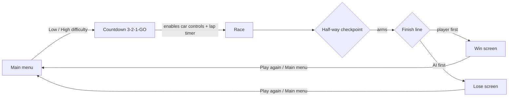

# Wrecking Ball: 3D Car Racing Game


A single-player 3D racing game built with Unity. Race against AI opponents on two tracks:
a smaller track with one rival, and a town circuit with two. Get through the countdown,
drive a full lap through the checkpoints, and cross the line first.

Built in 2018 as a university team project.

## Features

- **Two difficulty levels**
  - *Low*: the smaller track against one AI car.
  - *High*: a town circuit (built with Town Creator Kit LITE) against two AI cars.
- **Waypoint-driven AI**: each AI car chases a marker that steps along a chain of up to
  32 waypoints around the track. The marker advances when the car reaches it.
- **Lap logic with a half-way checkpoint**: a lap only counts after you pass the half-way trigger,
  so you can't cut back across the finish line.
- **Race HUD**: "3-2-1-GO" countdown with audio, a live lap timer (mm:ss.t) and a lap counter.
- **Finish screen**: a finish camera, a win or lose banner, and *Play again* / *Main menu* buttons.
- **Main menu** with a music volume slider.

## Controls

| Action | Keys |
| --- | --- |
| Accelerate / brake & reverse | `W` / `S` or `↑` / `↓` |
| Steer | `A` / `D` or `←` / `→` |
| Handbrake | `Space` |

## Running the project

1. Install **Unity 2017.3** (2017.3.1f1 was used) from the [Unity download archive](https://unity.com/releases/editor/archive).
   Newer editors can open the project too. They upgrade it on first open, which may need some fixes.
2. Clone the repository. It is about 150 MB because of the art assets.
   ```bash
   git clone https://github.com/muhammedts/Car-Racing-game-with-unity.git
   ```
3. Open the folder from Unity Hub, load `Assets/_Scenes/Menu.unity` and press **Play**.

To make a standalone build, open **File → Build Settings**. The scenes `Menu`, `road asmaa and moaaz` and `Track`
are already in the build list.

> **Music:** the original background track was a commercial song, so it was removed.
> To have menu music, drop any royalty-free clip into the `AudioScript` component's *Music Clip* slot.

## How it works



The game scripts are in [`Assets/Scripts`](Assets/Scripts):

| Script | What it does |
| --- | --- |
| `Countdown` | Runs the start countdown, then starts the lap timer and enables the cars |
| `CarControlActive` | Switches on the player's controls and the AI drivers when the race starts |
| `WaypointMarker` | Base class that moves an AI car's target marker from waypoint to waypoint |
| `AIcar`, `AICar2`, `AIcartrack` | The waypoint lists for each AI car on each track |
| `HalfPointTrig`, `HalfPointAI`, `HalfPointsecondAI` | Half-way checkpoints that arm the finish line |
| `LapComplete`, `LapCompleteAI`, `LapCompletesecondAI` | Count laps for the player and the AI cars |
| `LapTimeManager` | The on-screen lap timer |
| `Racefinish`, `NewBehaviourScript` | Finish lines that decide win or lose (town track / smaller track) |
| `MainMenu` | Menu and end-screen button handlers |
| `CameraController`, `AudioScript`, `FinishRotate`, `StartTimer`, `startontrack` | Camera, music and small helper triggers |

Vehicle physics, the player car controller and the AI steering come from Unity's
**Standard Assets** (`CarController`, `CarUserControl`, `CarAIControl`).

## Project structure

```
Assets/
├── _Scenes/      # Menu, Track (smaller track), road asmaa and moaaz (town track)
├── Scripts/      # game logic (see table above)
├── Prefabs/      # cars, track pieces, scenery packs (Standard Assets, Town Creator Kit LITE, ...)
├── Audio/        # countdown sound effects
├── Animations/   # countdown animation
├── Materials/, textures/, Models/, Shaders/
└── plugin/       # TextMesh Pro
ProjectSettings/  # Unity project settings, tags (playercar, AIcar, AIsecondcar), input axes
```

## Credits

- University team project, 2018.
- Third-party assets: Unity Standard Assets (vehicles, cameras), TextMesh Pro, Town Creator Kit LITE,
  and scenery packs (Ornamental Flower Set, Olive Tree, Road Blocker). They keep their own licences.

## Notes on the 2026 clean-up

The scripts were tidied without the Unity editor, so every public field and every UI method name the scenes
use was kept. The 32-way `if` chains in the AI scripts became a shared `WaypointMarker` base class.
Duplicate lap-time formatting and race-end code became one helper each. A missing *Main menu* button on one
lose screen was fixed, and debug logging and empty methods were removed.
